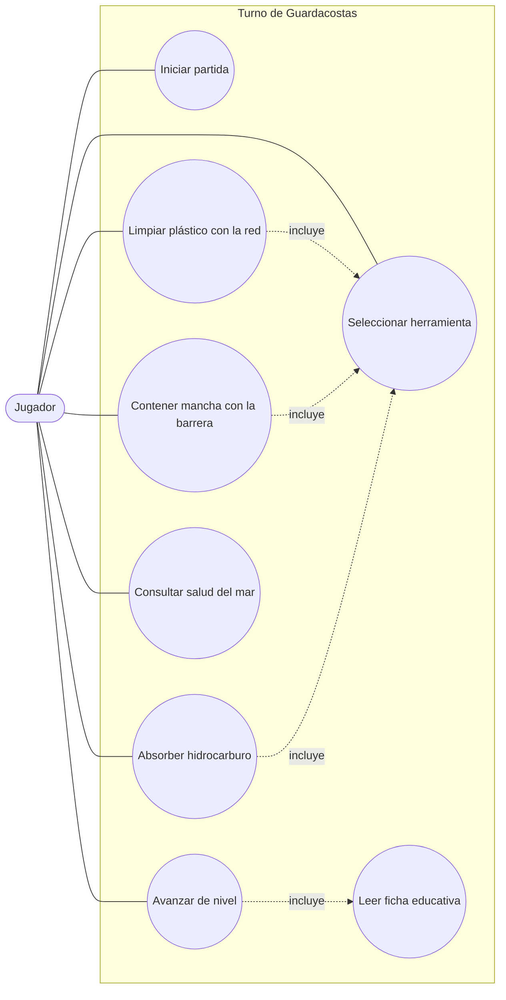
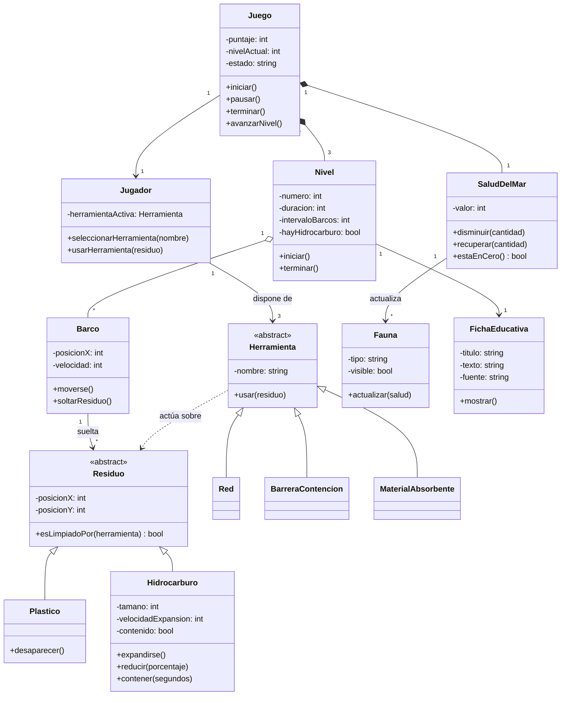

# Turno de Guardacostas — Documentación UML

Bienvenido a la documentación de arquitectura y diseño de **Turno de Guardacostas**. Este documento explica los diagramas UML que definen el comportamiento funcional y la estructura interna del juego, sirviendo como guía de referencia para el equipo de desarrollo.

---

## Índice
1. [Visión General del Sistema](#visión-general-del-sistema)
2. [Diagrama de Casos de Uso](#diagrama-de-casos-de-uso)
   - [Guía de lectura y elementos](#guía-de-lectura-y-elementos)
   - [Catálogo de Casos de Uso y Requerimientos](#catálogo-de-casos-de-uso-y-requerimientos)
   - [Procesos automáticos del sistema](#procesos-automáticos-del-sistema)
3. [Diagrama de Clases](#diagrama-de-clases)
   - [Guía de lectura y relaciones](#guía-de-lectura-y-relaciones)
   - [Decisiones clave de arquitectura](#decisiones-clave-de-arquitectura)

---

## Visión General del Sistema

**Turno de Guardacostas** es un videojuego educativo centrado en la limpieza y preservación marina. Los diagramas presentados aquí modelan el proyecto desde dos perspectivas complementarias:
- **Perspectiva Funcional (`casos-de-uso.md`):** Qué puede hacer el jugador dentro del sistema y cómo se relaciona con los requerimientos funcionales (`docs/SRS.md`).
- **Perspectiva Estructural (`diagrama-de-clases.md`):** Cómo se construirá el código, qué entidades existen, qué datos almacenan y cómo interactúan entre sí.

---

## Diagrama de Casos de Uso

Este diagrama delimita las interacciones directas entre el usuario y el videojuego.

### Guía de lectura y elementos
* **Actor (`Jugador`):** Representado por el óvalo exterior. Es el único rol humano en el sistema (no existen cuentas de administrador ni perfiles guardados en servidor).
* **Límites del sistema (`Turno de Guardacostas`):** El recuadro engloba todas las acciones que ejecuta el software.
* **Casos de uso (Círculos):** Acciones concretas que el jugador puede iniciar o experimentar.
* **Asociación (Línea continua):** Indica participación directa del jugador en esa acción.
* **Relación `<<include>>` (Línea punteada):** Indica dependencia obligatoria. Por ejemplo, para ejecutar cualquier acción de limpieza (`U3`, `U4`, `U5`), es requisito previo haber ejecutado *Seleccionar herramienta* (`U2`). Del mismo modo, *Avanzar de nivel* (`U8`) siempre desencadena *Leer ficha educativa* (`U7`).

### Catálogo de Casos de Uso y Requerimientos

| Caso de uso | Acción del jugador | Requerimiento vinculado |
| :--- | :--- | :---: |
| **Iniciar partida** | Pulsa el botón "Jugar" en el menú principal. | `RF-01` |
| **Seleccionar herramienta** | Elige entre red, barrera o absorbente en la barra inferior. | `RF-03` |
| **Limpiar plástico con la red** | Hace clic sobre un residuo plástico teniendo la red equipada. | `RF-04` |
| **Contener mancha con la barrera** | Coloca una barrera sobre un derrame para frenar su expansión. | `RF-05` |
| **Absorber hidrocarburo** | Aplica material absorbente para reducir el tamaño de la mancha. | `RF-05` |
| **Consultar salud del mar** | Monitorea el indicador visual de salud para priorizar amenazas. | `RF-07` |
| **Leer ficha educativa** | Visualiza el dato ecológico real al finalizar un nivel. | `RF-08` |
| **Avanzar de nivel** | Cierra la ficha educativa para dar paso al siguiente escenario. | `RF-09` |

### Procesos automáticos del sistema
Existen mecánicas definidas en el SRS que **no aparecen como casos de uso** porque son ejecutadas de forma autónoma por el motor del juego sin intervención del jugador:
1. **Generación de residuos:** Los barcos arrojan contaminación periódicamente (`RF-02`).
2. **Penalizaciones:** El sistema resta salud o puntos si se usa la herramienta incorrecta sobre un residuo (`RF-06`).
3. **Comportamiento de la fauna:** Los animales aparecen o desaparecen dinámicamente según el nivel de salud del ecosistema (`RF-10`).

---

## Diagrama de Clases

Este diagrama detalla la arquitectura orientada a objetos del juego completo, especificando atributos (datos) y métodos (comportamientos).

### Guía de lectura y relaciones
* **Visibilidad (`-` / `+`):** El signo `-` indica atributos o métodos **privados** (encapsulados dentro de la clase), mientras que `+` indica elementos **públicos** accesibles por otras clases.
* **Clases Abstractas (`<<abstract>>`):** Plantillas base que no se instancian directamente (`Residuo` y `Herramienta`), diseñadas para definir contratos comunes.
* **Herencia (`<|--`):** Relación *"es un tipo de"*. Por ejemplo, `Plastico` e `Hidrocarburo` heredan coordenadas y lógica base de `Residuo`, pero implementan sus propios comportamientos.
* **Composición (`*--`):** Relación de propiedad fuerte. `Juego` está compuesto por `3` instancias de `Nivel` y `1` de `SaludDelMar`. Si la partida se destruye, estos objetos también.
* **Agregación (`o--`):** Relación de contención débil. Un `Nivel` gestiona múltiples instancias de `Barco`, los cuales operan con ciclo de vida independiente durante la partida.
* **Asociación (`-->`) y Dependencia (`..>`):** Indican comunicación entre clases. Por ejemplo, `Herramienta` depende temporalmente de `Residuo` al momento de ejecutar `usar(residuo)`, sin almacenar una referencia permanente a él.

### Decisiones clave de arquitectura
1. **Polimorfismo en Residuos y Herramientas:** Se optó por dos jerarquías paralelas para facilitar la escalabilidad. Si en el futuro se añade un nuevo contaminante (ej. redes fantasma), basta con heredar de `Residuo` sin modificar la lógica central del `Juego`.
2. **Centralización de la condición de derrota:** La clase `SaludDelMar` encapsula la métrica crítica del ecosistema (`estaEnCero()`), evitando que la lógica de fin de juego quede dispersa entre niveles o residuos.
3. **Desacoplamiento de la Fauna:** `SaludDelMar` notifica a `Fauna` (`actualizar(salud)`), y no a la inversa. Esto garantiza que el sistema visual de animales (`RF-10`, de prioridad baja) pueda modificarse o desactivarse sin comprometer las mecánicas principales de limpieza.
