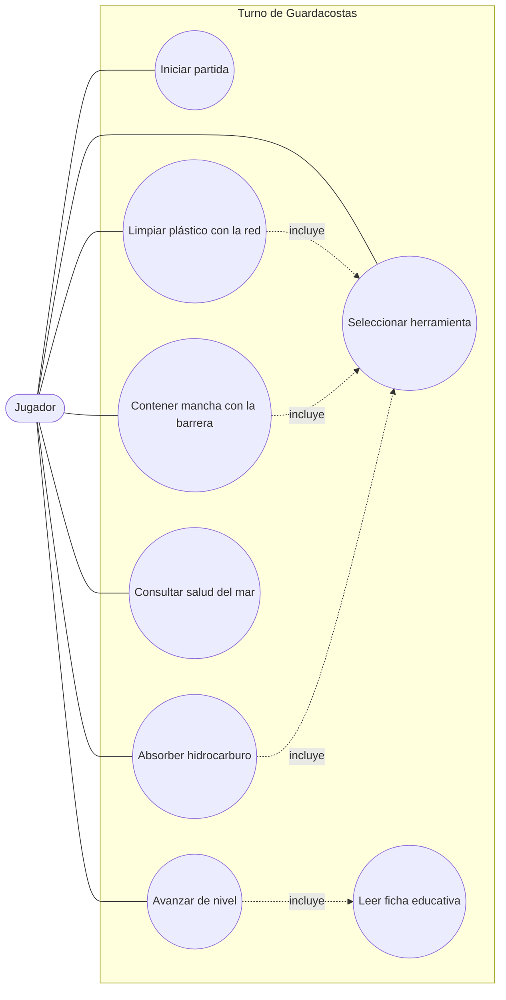

# Diagrama de casos de uso general — Turno de Guardacostas

Muestra qué puede hacer el jugador con el sistema. Los casos de uso salen de los requerimientos funcionales de `docs/SRS.md`.

## Cómo leerlo

- **Actor** (`Jugador`, en forma de óvalo con bordes redondeados): la persona que usa el juego. Es el único actor, porque no hay administradores ni usuarios registrados.
- **Caso de uso** (círculo): algo que el jugador puede hacer.
- **Caja "Turno de Guardacostas"**: los límites del sistema. Todo lo que está dentro lo hace el juego.
- **Línea continua**: el jugador participa en ese caso de uso.
- **Línea punteada "incluye"**: el caso de uso de origen siempre usa el de destino. Por ejemplo, para limpiar con la red hay que haber seleccionado una herramienta, y al avanzar de nivel siempre se lee una ficha.

## Descripción de los casos de uso

| Caso de uso | Qué hace el jugador | Requerimiento |
|---|---|---|
| Iniciar partida | Pulsa "Jugar" en el menú principal | RF-01 |
| Seleccionar herramienta | Elige red, barrera o absorbente en la barra | RF-03 |
| Limpiar plástico con la red | Hace clic con la red sobre un plástico | RF-04 |
| Contener mancha con la barrera | Hace clic con la barrera sobre el hidrocarburo para frenar su expansión | RF-05 |
| Absorber hidrocarburo | Hace clic con el absorbente para reducir la mancha | RF-05 |
| Consultar salud del mar | Mira la barra de salud para decidir qué limpiar primero | RF-07 |
| Leer ficha educativa | Lee el dato real que aparece al terminar un nivel | RF-08 |
| Avanzar de nivel | Cierra la ficha y comienza el siguiente nivel | RF-09 |

## Lo que hace el sistema por su cuenta

Algunas funciones no las inicia el jugador y por eso no aparecen como casos de uso: la generación de residuos por los barcos (RF-02), la penalización por usar la herramienta equivocada (RF-06) y la fauna que reacciona a la salud del mar (RF-10).
