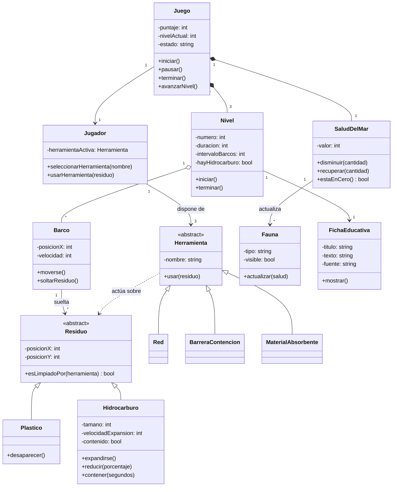

# Diagrama de clases — Turno de Guardacostas

Muestra las piezas con las que se construirá el juego, sus datos (atributos) y sus acciones (métodos). Cubre todo el juego, que es el módulo del equipo.

## Cómo leerlo

- **Cada caja** es una clase: el molde de un objeto. El apartado de arriba son sus datos y el de abajo sus acciones.
- **`-` y `+`:** `-` es un dato privado (solo la propia clase lo usa) y `+` es una acción pública (otras clases pueden pedirla).
- **`<<abstract>>`:** una clase abstracta no se usa sola, sirve de base para otras. `Residuo` es la base de `Plastico` e `Hidrocarburo`; `Herramienta` lo es de `Red`, `BarreraContencion` y `MaterialAbsorbente`.
- **Flecha con triángulo vacío (`<|--`):** herencia, "es un tipo de". Una `Red` es un tipo de `Herramienta`.
- **Rombo relleno (`*--`):** composición. `Juego` contiene 3 `Nivel` y 1 `SaludDelMar`, y si el juego termina, también terminan ellos.
- **Rombo vacío (`o--`):** agregación. Un `Nivel` tiene varios `Barco`, pero los barcos tienen existencia propia.
- **Flecha simple (`-->`):** una clase usa o conoce a la otra. `"1"` y `"*"` indican cuántos hay (uno o muchos).
- **Flecha punteada (`..>`):** dependencia. Las herramientas actúan sobre los residuos, pero no los poseen.

## Decisiones de diseño

- **Dos jerarquías con herencia** (residuos y herramientas) porque comparten datos y comportamiento pero cada tipo reacciona distinto. Por ejemplo, `Hidrocarburo` se expande y `Plastico` no.
- **`SaludDelMar` es una clase propia** para que la derrota dependa de un solo lugar.
- **La clase `Fauna` depende de la salud del mar** y no al revés, para que se pueda quitar sin afectar el resto (es el RF-10, de prioridad baja).
